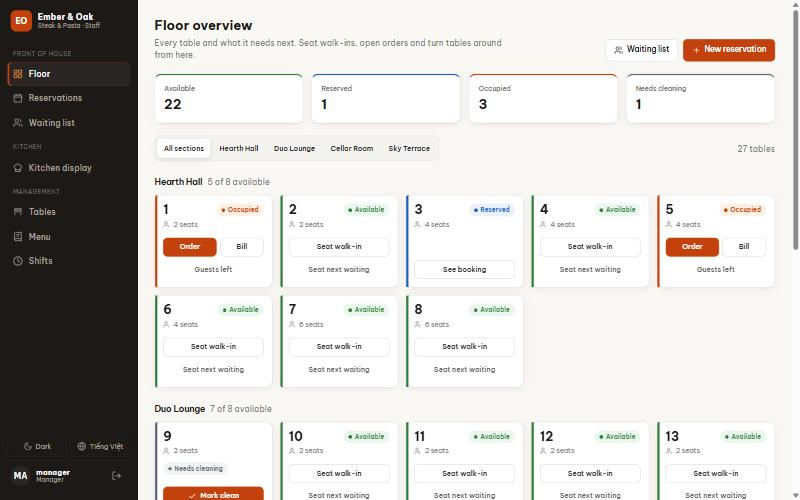
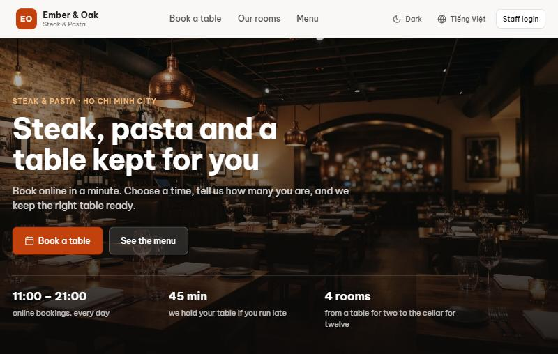
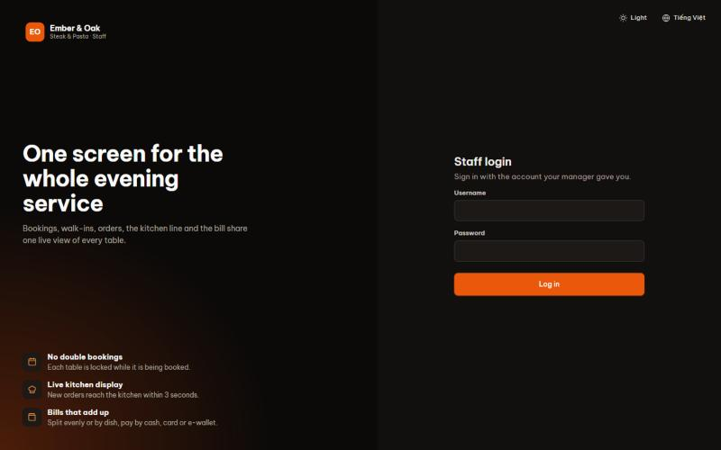
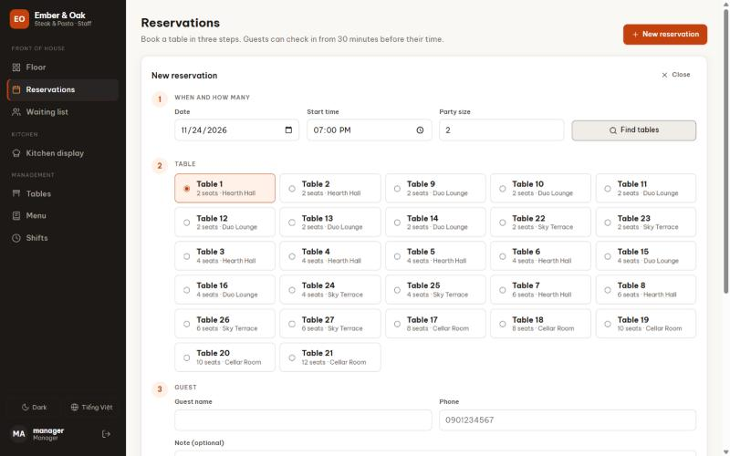
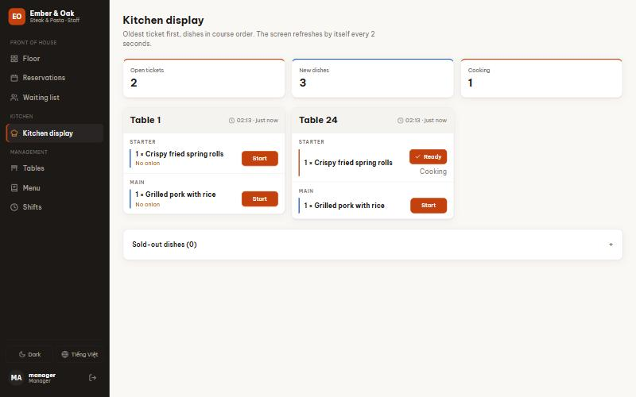
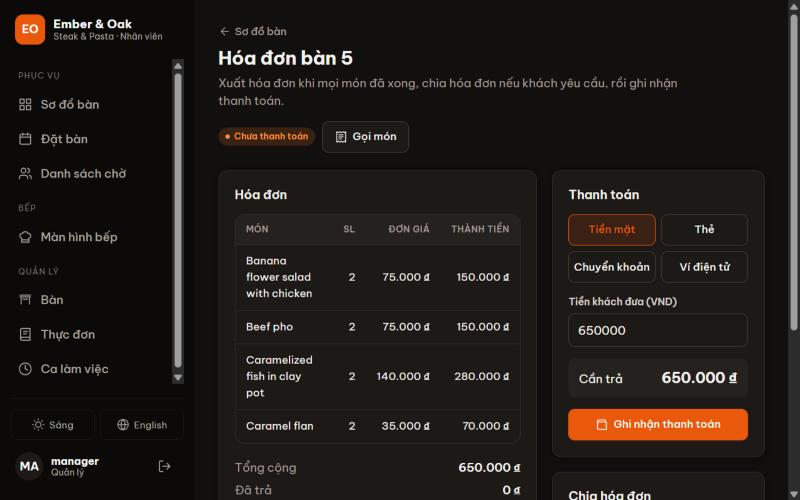

# Ember & Oak · Restaurant Table Booking and Kitchen Order System

A web application that runs the front of house, the kitchen and the till of a small or medium-sized restaurant from one shared, live view of every table.

Course project for **72ITSE41704 Application Programming Project**, Van Lang University, semester 1, 2026-2027. Lecturer: Dr. Nguyen Tri Hai.



---

## 1. The problem

Many small restaurants still run service on a notebook, a chat app and word of mouth. On 18/10/2026 the team interviewed staff of a steak and pasta restaurant in Ho Chi Minh City. In this project the restaurant is called **"Ember & Oak"** to keep it anonymous. The interview showed where things go wrong:

- **Reservations arrive by social-media message**, so the same table can be promised twice, or given to walk-in guests just before a booked party arrives.
- **No-shows are the most common problem.** The staff hold a late booking for 45 minutes, but nothing tracks that time.
- **Walk-in guests wait at the door with no fair order.**
- **The ordering app is not linked to tables or bills.** Sold-out dishes are passed on by word of mouth.
- **The till is reconciled by hand** at the end of a shift, from cash counts and screenshots of bank transfers.

## 2. What the system does

One application with three staff roles. Each role sees only its own screens, and the server checks the role again on every request.

| Role | What they do |
|---|---|
| **Guest** (no login) | Guest website at http://localhost:8080: book a table online and browse the menu. The system picks the smallest free table that fits, and the booking appears on the staff screens at once. |
| **Waiter/Host** | Floor overview, reservations, check-in, walk-ins and the waiting list, orders, bills and payments |
| **Kitchen Staff** | Kitchen display: start and finish dishes in course order; mark dishes sold out |
| **Manager** | Everything above, plus tables and sections, the menu, reservation timings, and shifts with their reports |

### Modules

| Module | Owner | Highlights |
|---|---|---|
| **Table & Reservation** | Kieu Bao Giang | 3-step booking, no double booking (also for two bookings at the same second), check-in from 30 min before, automatic no-show after 45 min, waiting list in arrival order, table lifecycle |
| **Order & Kitchen** | Tang Thoai Lam | Order per occupied table, dishes sent in course order, live kitchen display, sold-out dishes disappear from order screens, moving an order to another table |
| **Billing & Reporting** | Nguyen Nam Khoa | Bill when the kitchen is done, even split or split by dish, cash / card / bank transfer / e-wallet with change, shifts, shift report with a cash check |

### Business rules enforced on the server

| Rule | Meaning |
|---|---|
| BR-01 | No double booking: one table cannot have two bookings within 180 min dining + 15 min turn-time (both set by the Manager) |
| BR-02 | A party is only seated at a table with enough seats |
| BR-03 | A table that needs cleaning cannot be given to new guests |
| BR-04 | Walk-ins are seated in arrival order; a later party goes first only if no earlier one fits the free table |
| BR-05 | Table lifecycle: Available → Reserved → Occupied → Needs cleaning → Available |
| BR-06 | Dishes go to the kitchen in course order: starters, then mains, then desserts |
| BR-07 | A sold-out dish cannot be ordered |
| BR-08 | A dish cannot be changed once the kitchen has started it |
| BR-09 | A bill is generated only when every dish is ready |
| BR-10 | An even split rounds to 1,000 VND and always adds up to the bill total |
| BR-11 | Card, transfer and e-wallet payments cannot exceed the amount due; cash can, and the change is shown |
| BR-12 | A closed bill can no longer be changed |
| BR-13 | Payments need an open shift; a shift cannot close while a bill is unpaid |

### Interface

- Dark sidebar layout that matches the approved design preview (`docs/design/ui-demo.html`).
- **Light and dark theme**, and an **English / Tiếng Việt** switch. Both are in the sidebar and on the login screen, and the choice is remembered in the browser.
- Works from phone width up; on a small screen the sidebar becomes a slide-in menu.

- **Guest website** at `/`, in the same style.
  - Booking form: name, phone, date, time (only times with a free table can be picked), number of guests, note.
  - The menu shows a short preview by category; "See the full menu" opens the whole list.
  - Dish names follow the English / Tiếng Việt switch.
- **Staff app** at `/login`. The demo accounts are listed in small print under the login form.

| | |
|---|---|
|  |  |
|  |  |
|  |  |

---

## 3. Run the project

### Option A: double-click `start.bat` (Windows, recommended)

**Install once:**
- **Java 17 or later**, for example [Eclipse Temurin](https://adoptium.net). Check with `java -version`.
- **Node.js 18 or later** (LTS) from [nodejs.org](https://nodejs.org). Check with `node -v`.

Maven does **not** need to be installed: the project uses the Maven Wrapper (`src/backend/mvnw.cmd`), which downloads it on the first run.

**Run:** double-click **`start.bat`** in the project folder. It:
1. builds the web interface (`npm install` on the first run, then `npm run build`);
2. builds the server with the Maven Wrapper;
3. starts everything on **http://localhost:8080** and opens the browser when the app is ready.
   - http://localhost:8080 is the guest website.
   - http://localhost:8080/login is the staff app.

The first run downloads libraries and takes a few minutes; later runs start in under a minute.

**Stop:** close the window, or press `Ctrl+C` in it. There is no separate stop file.

**Database:** chosen automatically.
- If `src/backend/application-local.properties` exists, the app uses **MySQL** and keeps its data (see below).
- Otherwise it uses an **in-memory H2 database** with sample data, created again on every start. Nothing else needs to be installed.

### Option B: run the parts separately (for development)

**Backend** (http://localhost:8080):
```bash
cd src/backend
mvnw.cmd spring-boot:run -Dspring-boot.run.profiles=h2
```
On macOS or Linux use `./mvnw`. Leave out `-Dspring-boot.run.profiles=h2` to use MySQL.

**Frontend** with hot reload (http://localhost:5173). Vite forwards `/api` to the backend, so start the backend first.
```bash
cd src/frontend
npm install
npm run dev
```

> **Windows path tip:** in a folder whose path has Vietnamese accents, `spring-boot:run` can fail with `ClassNotFoundException`. `start.bat` avoids this by packaging a jar and running `java -jar`. For Option B, keep the clone in a plain path such as `C:\dev\restaurant`.

### Using MySQL instead of H2

1. Install MySQL 8.
2. Create `src/backend/application-local.properties`. It is git-ignored, so the password is never committed.
   ```properties
   spring.datasource.username=root
   spring.datasource.password=your_mysql_password
   ```
3. Start the app.
   - The database `restaurant_booking` is created on the first start.
   - Flyway builds the tables with migrations `V1` to `V4`.

### Sample accounts

Created on the first start (`DataSeeder`). These are demo accounts: change the passwords, or switch seeding off with `app.seed.enabled=false`, before real use.

| Username | Password | Role | First screen |
|---|---|---|---|
| manager | Manager@2026 | Manager | Floor overview |
| waiter | Waiter@2026 | Waiter/Host | Floor overview |
| kitchen | Kitchen@2026 | Kitchen Staff | Kitchen display |

**Sample data (also seeded):**
- 4 sections and 27 tables: Hearth Hall, Duo Lounge, Cellar Room and Sky Terrace.
- 29 dishes.
- 12 past orders with their bills and shifts, so the shift reports have data. Turn these off with `app.seed.sample-orders=false`.

The Manager opens a shift in **Shifts** before the first bill of the day. `docs/run-guide.md` walks through one whole visit, from seating the guests to the shift report.

### Tests

```bash
cd src/backend
mvnw.cmd test
```

The tests run on H2, so MySQL is not needed. They cover:
- the business rules;
- two bookings of one table at the same moment;
- end-to-end visits across the three modules.

The documented test cases, with expected and actual results, are in `tests/`.

---

## 4. Technology

| Layer | Technology | Why |
|---|---|---|
| Backend | Java 17, Spring Boot 3.5 (Web, Data JPA, Security, Validation, Scheduling) | Layered architecture, session login with roles, validation on every request |
| Database | MySQL 8 with Flyway migrations; H2 for tests and the demo | Data survives restarts; the schema is versioned, one migration per module |
| Frontend | React 18, React Router 6, Vite 6, plain CSS | One page app; the built files are served by Spring Boot in `start.bat` |
| Tests | JUnit 5, Spring MockMvc, Spring Security Test | Business rules and APIs tested without a browser |

**Architecture:** `controller → service → repository → domain`.
- The business rules live in the domain classes and services. For example, `DiningTable.changeStatus` is the only way to change a table's status.
- Errors always come back as `{ message, fieldErrors }`, never as a stack trace.

```
src/backend/      Spring Boot application
  src/main/java/vn/edu/vlu/restaurant/
    controller/   REST endpoints (+ SpaController, which serves the React pages)
    service/      business rules and transactions
    repository/   Spring Data JPA
    domain/       entities with their own rules (DiningTable, Reservation, CustomerOrder, Bill, Shift ...)
    dto/          request and response records with validation
  src/main/resources/db/migration/   Flyway V1 to V4
src/frontend/     React app (pages/, components/, i18n-vi.js for Vietnamese)
tests/            documented test cases per module
docs/             proposal, requirements, interview, diagrams, report drafts, screenshots
start.bat         one-click local run
```

## 5. Documentation

| Path | What it contains |
|---|---|
| `docs/proposal/` | Project Proposal (Markdown draft, DOCX, PDF) |
| `docs/requirements/` | Module requirements and `requirement-changes.md` (CR-01 to CR-05 after the interview) |
| `docs/interview/` | Interview questions and notes |
| `docs/diagrams/` | UML, ERD, state and sequence diagrams, one folder per member |
| `docs/report/` | Final Report drafts, one file per member |
| `docs/run-guide.md` | Detailed run guide and a walkthrough of a whole visit |
| `docs/security-check.md`, `docs/self-check-week7.md` | Security check and the Week 7 rubric self-check |
| `docs/design/ui-demo.html` | Clickable design preview (open it in a browser) |

## 6. Team

| Name | Student ID | Role |
|---|---|---|
| Kieu Bao Giang (Team Leader) | 2474802010095 | Table & Reservation module, shared skeleton, login, user interface |
| Tang Thoai Lam | 2474802010210 | Order & Kitchen module |
| Nguyen Nam Khoa | 2474802010194 | Billing & Reporting module |

**Workflow:**
- `main` always builds.
- Every change comes through a short-lived branch and a pull request merged by another member.
- Commit messages are imperative.
- Release tags: `v0.1` (Week 5), `v0.2` (Week 7), `v1.0` (feature freeze).
