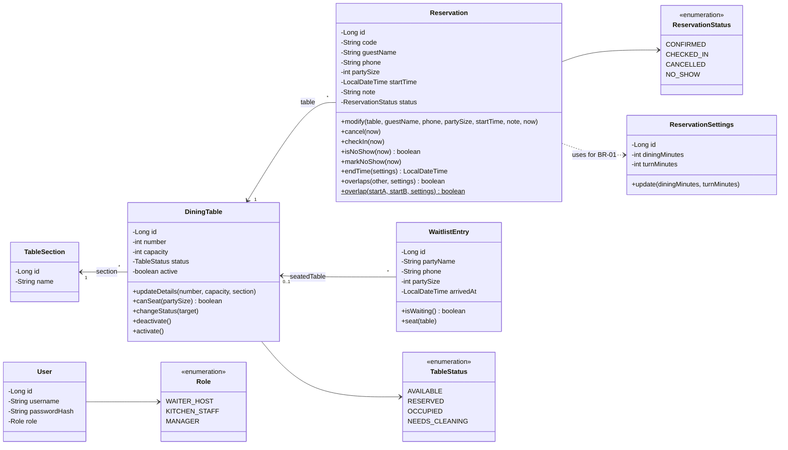
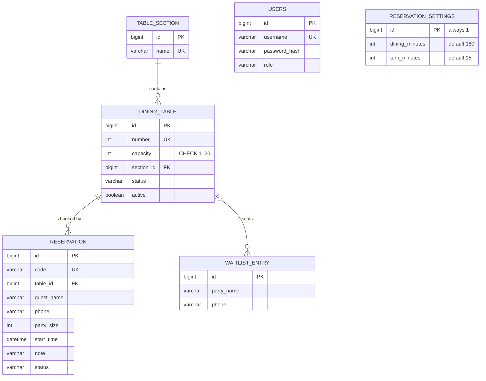
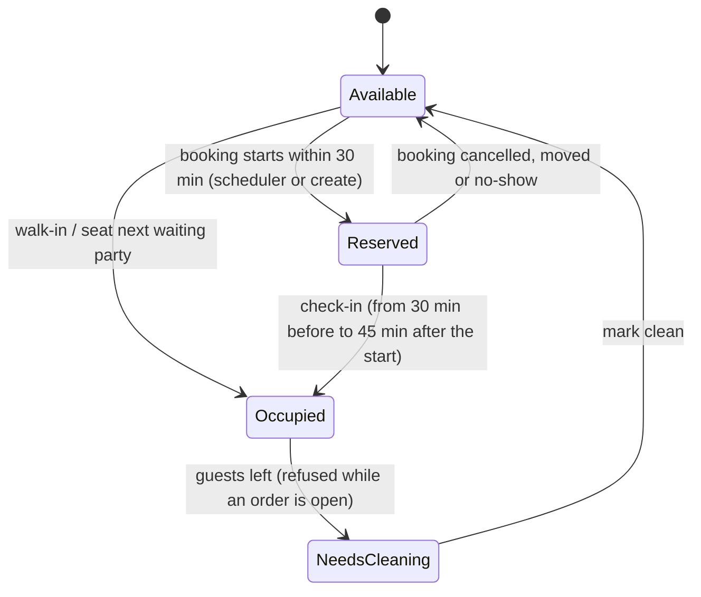
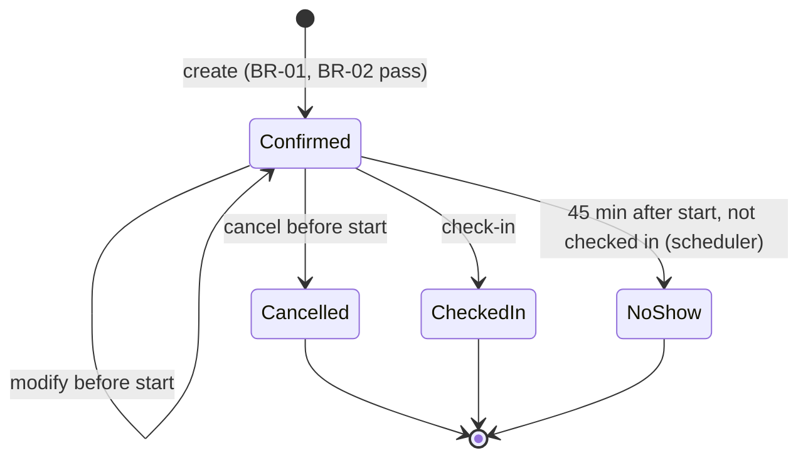
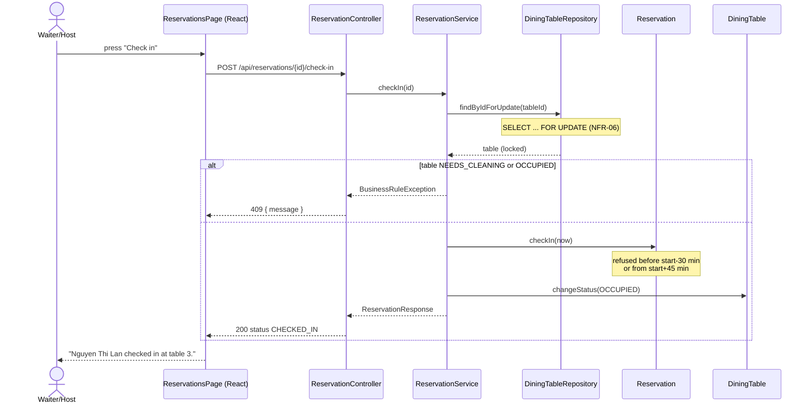
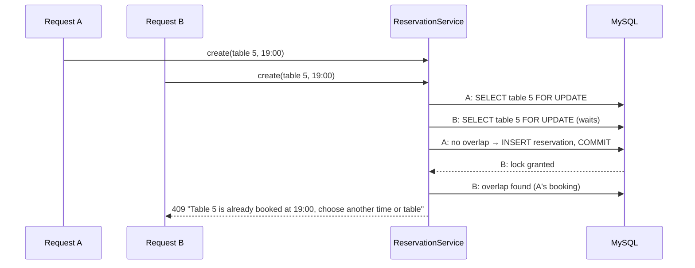

# Table & Reservation diagrams — updated for Week 8

The PNG files in this folder were drawn in Week 4, before the restaurant interview and before the Week 7 code.
The diagrams below replace them where the two differ. They match the code on branch `feature/giang-week7-10`.
GitHub renders Mermaid. PNG exports for the report are in `updated/` (`w8-*.png`, made with mermaid-cli at 2× scale).
Export them again after any change to a diagram below.

What changed since the Week 4 PNGs:
- Dining duration is 180 minutes, not 90 (CR-02). The no-show limit is 45 minutes (CR-01).
- New domain methods:
  - `DiningTable.changeStatus`
  - `Reservation.checkIn`, `markNoShow`, `overlap`
  - `WaitlistEntry.seat`
- New endpoints for check-in, walk-in, seat-next, needs-cleaning and clean.

## 1. Class diagram (domain layer)

## 2. ERD (Flyway `V1__table_reservation_module.sql`)

`users` also links to Lam's `customer_order.waiter_id` (V2).

## 3. Table state machine (BR-05)

Every other change is refused with "Table N cannot go from X to Y" (`DiningTable.changeStatus`).

## 4. Reservation state machine

## 5. Sequence — check-in (UC-04 step 4)

## 6. Sequence — two bookings at the same moment (NFR-06)

