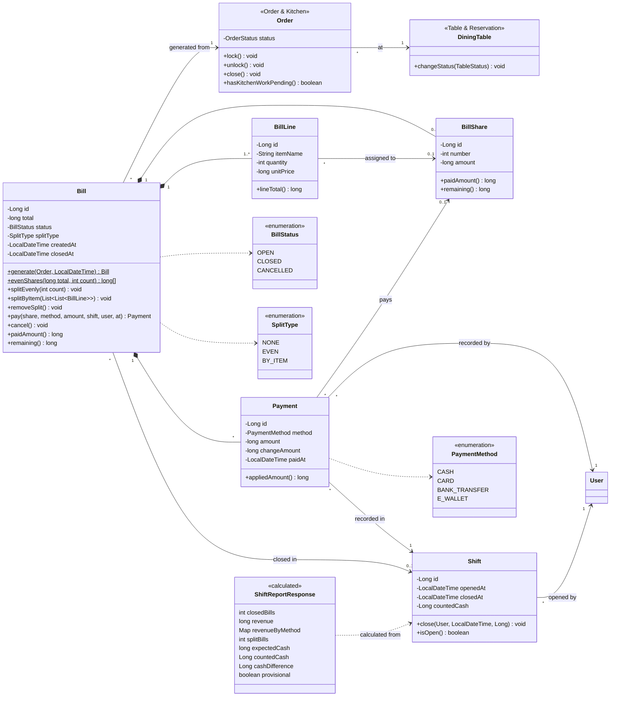
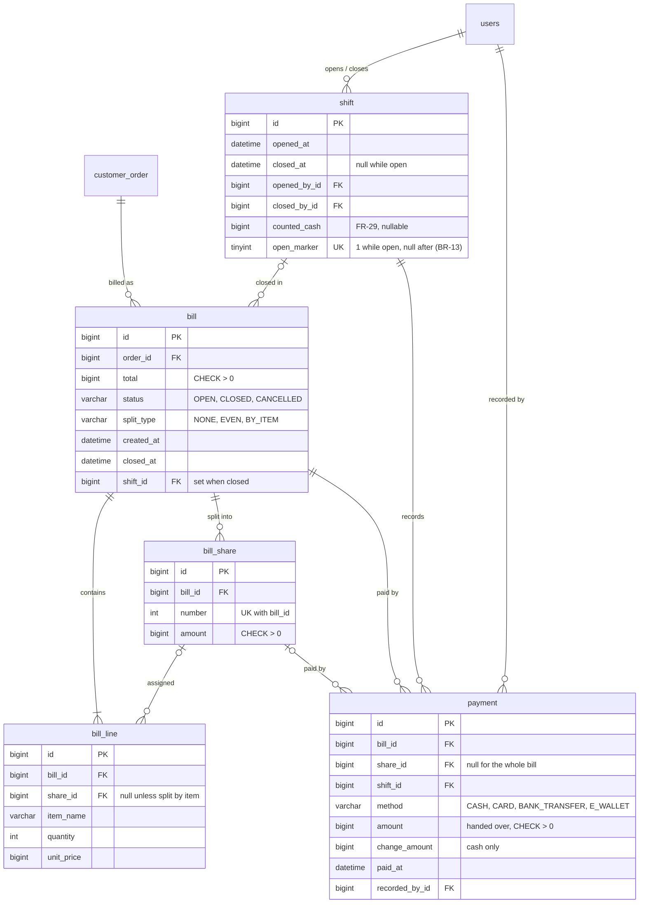
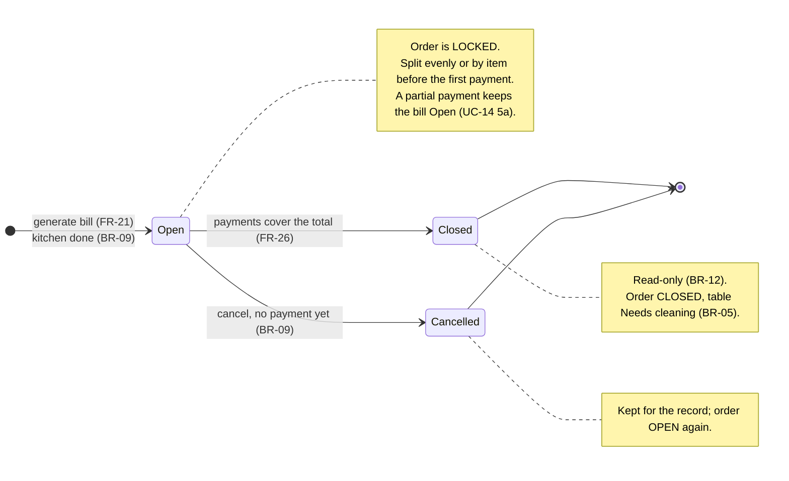
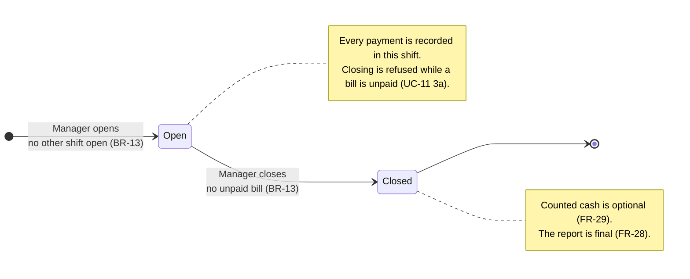
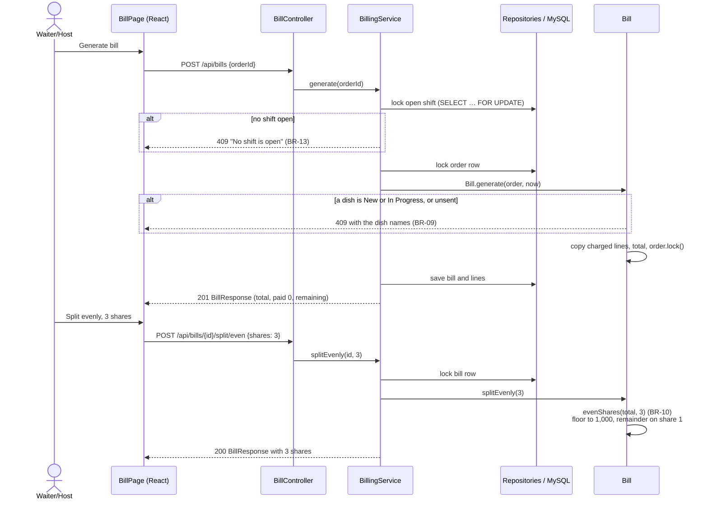
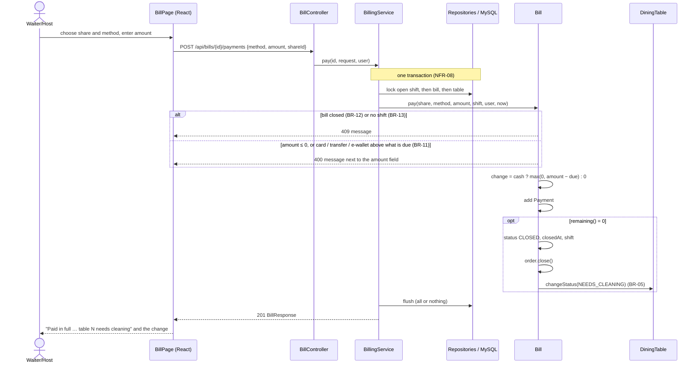

# Billing & Reporting diagrams (Nguyen Nam Khoa)

The PNG files in this folder are the Week 4 design. The diagrams below match the code as of 21/11/2026;
their images are in `updated/`. They are drawn from the classes in `src/backend/.../domain`, the Flyway script
`V4__billing_reporting.sql` and the services `BillingService` and `ShiftService`.

What changed since Week 4:
- **BillShare** has a `number` (1..N) so the waiter can say "share 2"; **BillLine** keeps a link to its share
  for a split by item (FR-24).
- **Bill** has `splitType` (NONE, EVEN, BY_ITEM), `closedAt` and the **Shift** in which it was closed, so the shift
  report counts each bill once (FR-28).
- **Payment** records who took it (`recordedBy`); `appliedAmount() = amount - changeAmount` is what pays the bill.
- **Shift** records who opened and closed it and the counted cash (FR-29, CR-05). `open_marker` is unique, so the
  database refuses a second open shift (BR-13).
- **PaymentMethod** has E_WALLET (CR-04).
- **ShiftReport** is not stored: it is calculated on request (`ShiftReportResponse`).

## 1. Class diagram

Image: `updated/w9-class-billing.png`

## 2. ERD

Image: `updated/w9-erd-billing.png`

## 3. Bill state machine

Image: `updated/w9-state-bill.png`

## 4. Shift state machine

Image: `updated/w9-state-shift.png`

## 5. Sequence: generate and split the bill (UC-12, UC-13)

Image: `updated/w9-sequence-generate-split.png`

## 6. Sequence: record payment and close the bill (UC-14)

Image: `updated/w9-sequence-pay-close.png`

