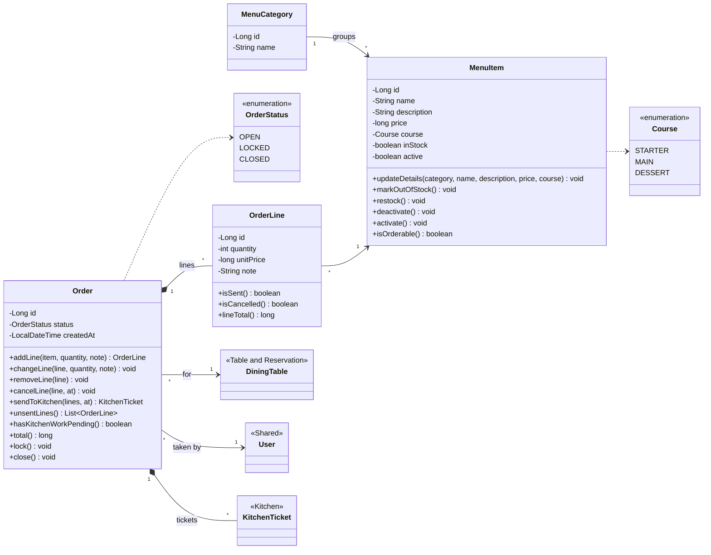
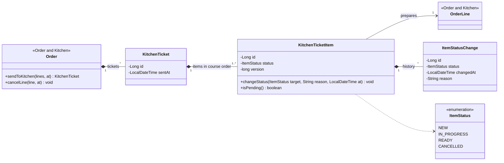
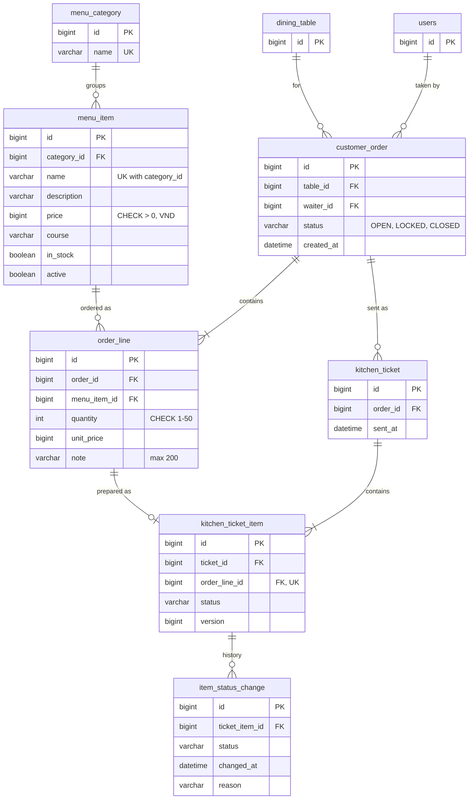
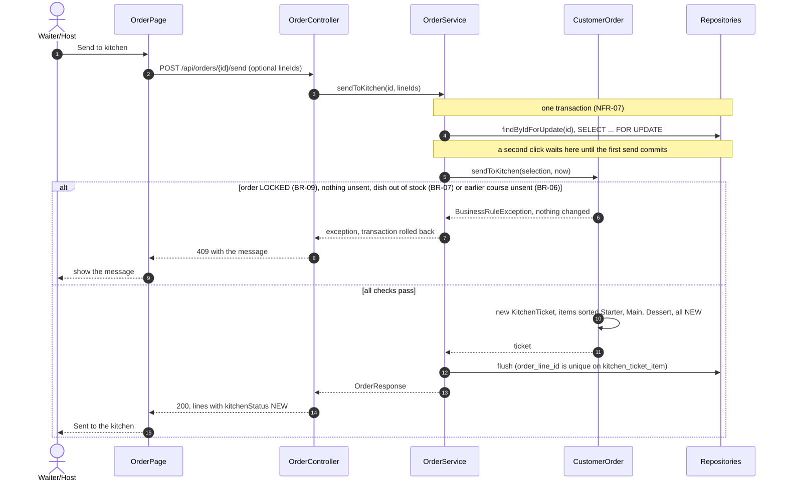
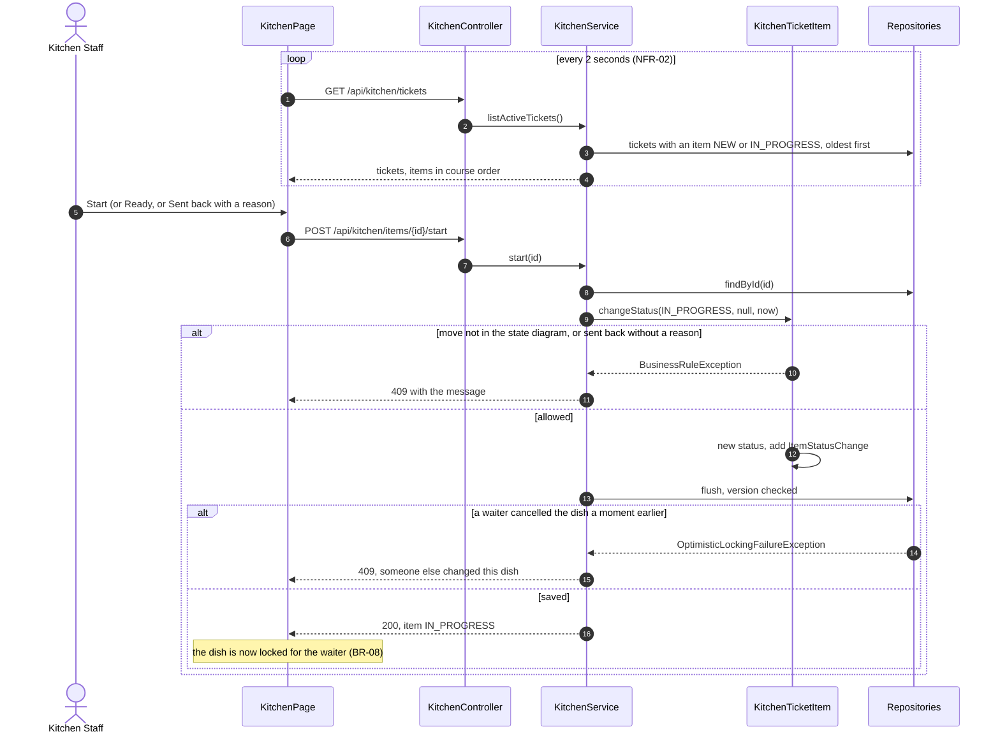
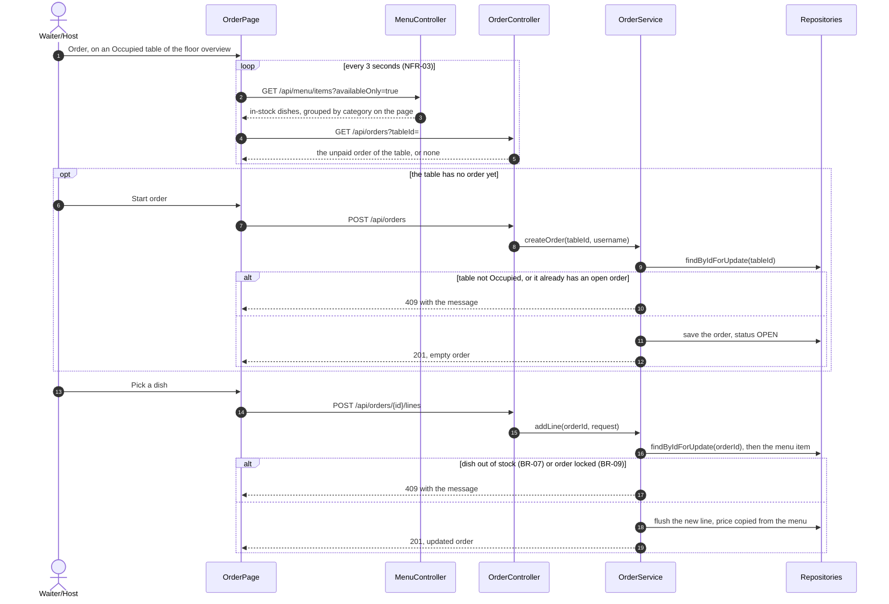

# Order & Kitchen diagrams (Tang Thoai Lam)

The PNG files in this folder are the Week 4 design. The diagrams below match the code as of 04/11/2026; their images are in `updated/`.
The ticket item and order state machines (`08-state-3-ticket-item.png`, `08-state-4-order.png`) still match the code and were not redrawn.

## 1. Class diagram, menu and order

Image: `updated/w8-class-order-menu.png`

## 2. Class diagram, kitchen tickets

Image: `updated/w8-class-kitchen-tickets.png`

## 3. ERD, Flyway V2 and V3

Image: `updated/w8-erd-order-kitchen.png`

## 4. Sequence, send to kitchen (UC-08 steps 4-7)

Image: `updated/w8-sequence-send-to-kitchen.png`

## 5. Sequence, kitchen display (UC-09)

Image: `updated/w8-sequence-kitchen-display.png`

## 6. Sequence, take an order (UC-08 steps 1-3)

Image: `updated/w8-sequence-take-order.png`

